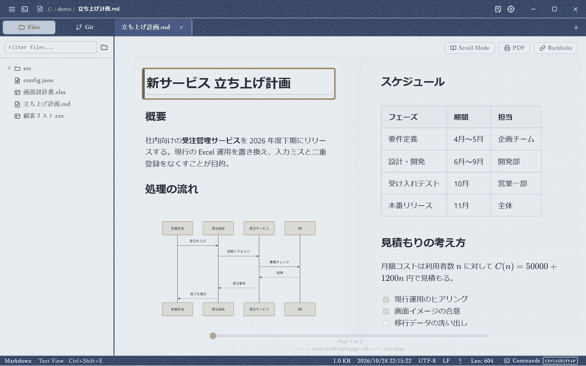
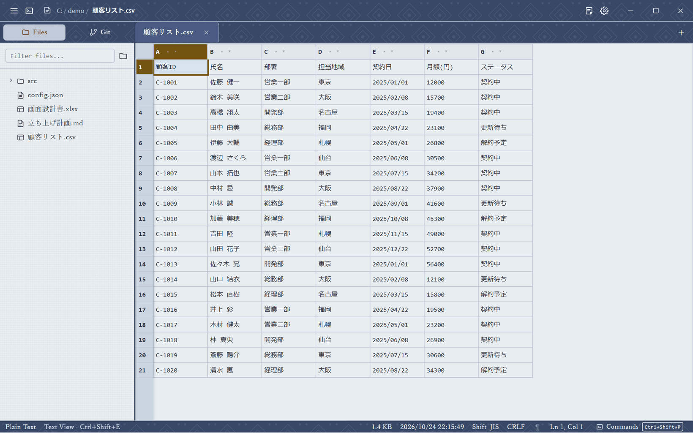
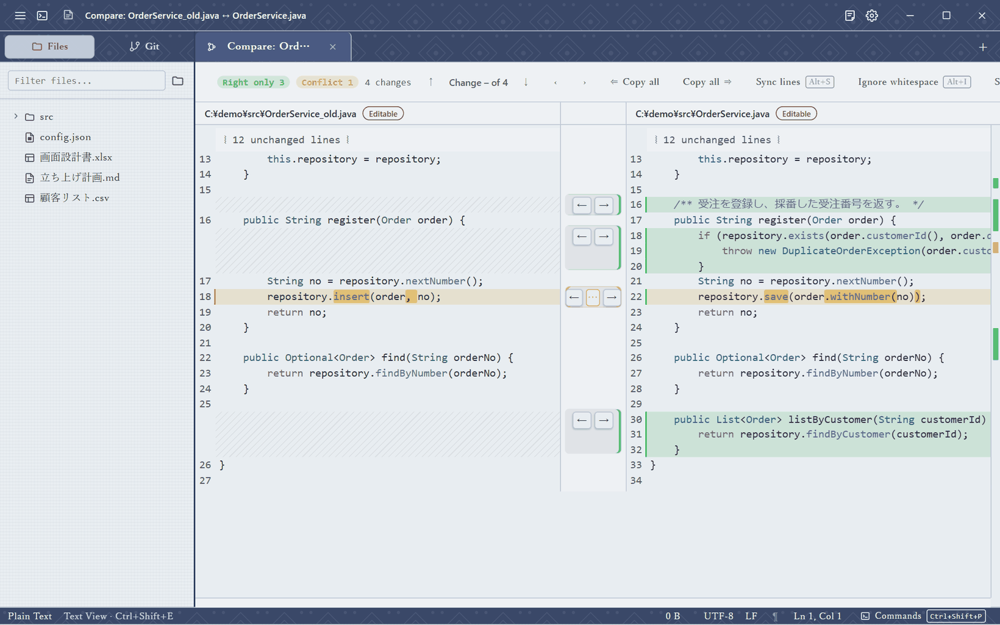
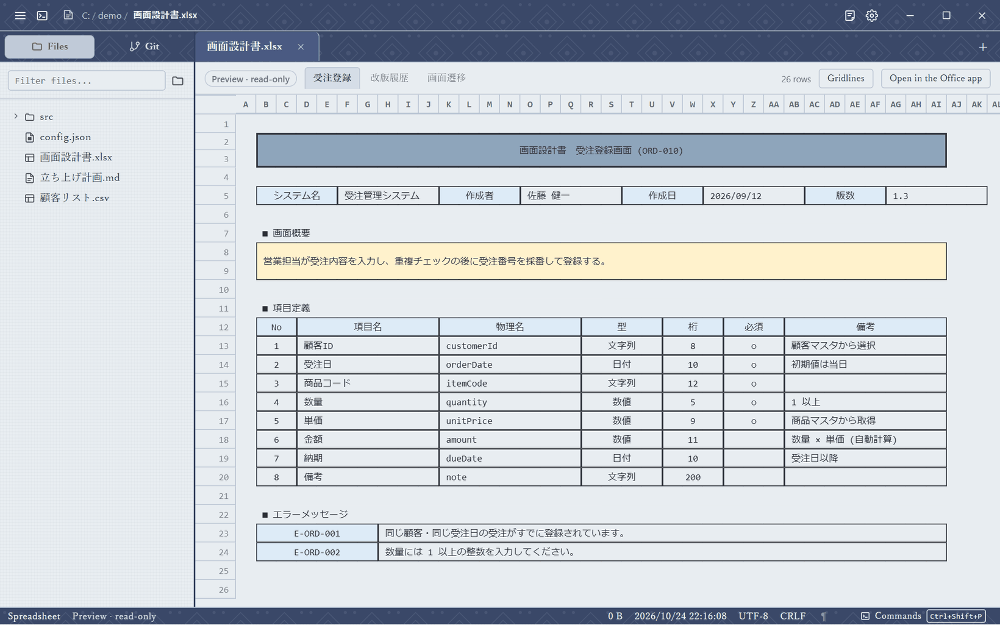
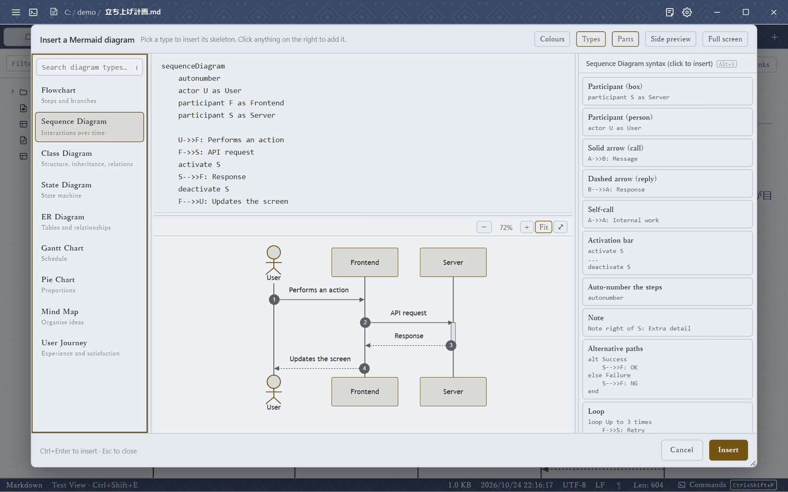
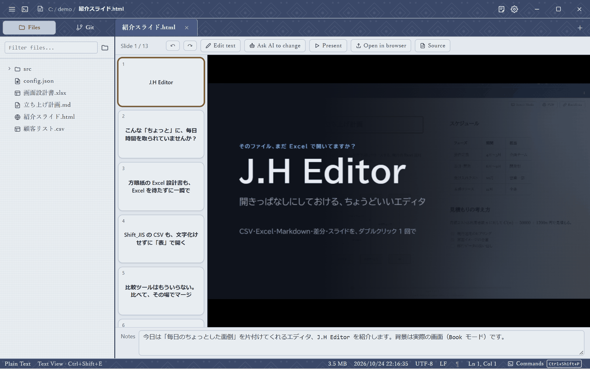
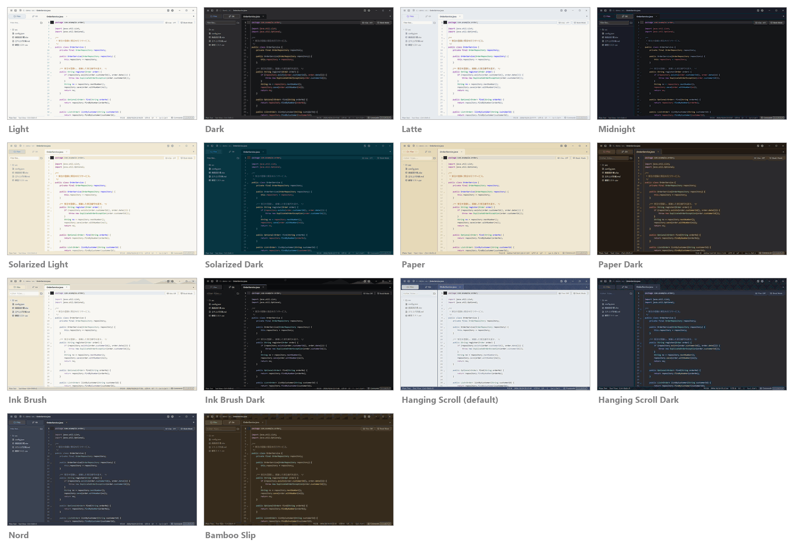
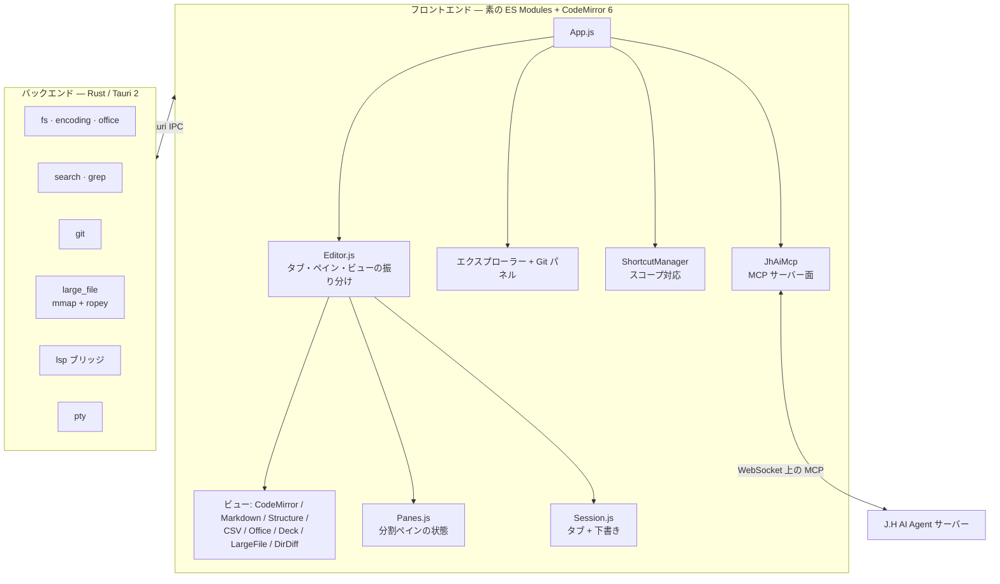

# J.H Editor

[English](README.md) | **日本語**

**Tauri 2**・**素の JavaScript**・**CodeMirror 6** で作った、ローカルファーストのデスクトップ用テキストエディターです。

<p align="center">
  <picture>
    <source media="(prefers-color-scheme: dark)" srcset="docs/images/hero-dark.png">
    
  </picture>
</p>
<p align="center">
  <em>ブックモード &mdash; 長い文書をページめくりで読む表示。Mermaid・表・数式もそのまま表示されます。
  テーマは既定の「掛軸」。スクリーンショットは GitHub のライト／ダーク設定に合わせて切り替わります。</em>
</p>

J.H Editor は、一日中開きっぱなしにしておくエディターを目指しています。プレーンテキストと
**Markdown** をすばやく扱うのが基本で、必要なときには構造化データのツール（CSV / JSON / XML / HTML）と
Git パネルも使えます。IDE になろうとはしていません。AI については**相棒**の役割に徹します。
LLM を内蔵するのではなく、編集中の文書を MCP 経由で外部のエージェントに渡します。

ダブルクリックしてから編集できるまで、1 秒を大きく切ります。エディターの準備が整うまでウィンドウを
表示しないので、白い画面のちらつきも、空の枠も出ません。

### こんな場面で

- **何千もの設計書から 1 冊を探して読む。** `Ctrl+Shift+R` で、ワークスペース全体を
  入力するそばから絞り込めます。名前でもパスでも glob（`*設計*.xlsx`）でも構いません。`Enter` を押せば
  Excel のブックが読み取り専用の Office プレビューで開き、列幅・セル結合・罫線もそのままです。
  Excel の起動を待つ必要はありません。
- **CSV を書式に崩されずに直す。** `.csv` は並べ替え・幅の変更・編集ができる表として開きます。
  セルは文字列のまま扱うので、日付がシリアル値に化けたり先頭の 0 が消えたりせず、Shift_JIS の
  ファイルは Shift_JIS のまま保存されます。
- **Markdown を読む表示で読み、ブロック単位で編集する。** `.md` は Mermaid・表・数式まで描画された
  状態で開きます。ダブルクリック（または `F2`）で、そのブロックだけをライブプレビューと並べて編集できます。

---

## スクリーンショット

<p align="center">
  <picture>
    <source media="(prefers-color-scheme: dark)" srcset="docs/images/csv-dark.png">
    
  </picture>
</p>
<p align="center">
  <em>CSV は表として開きます &mdash; 並べ替え、列幅の変更、行と列の入れ替え、Excel と同じ感覚の挿入・削除。
  Shift_JIS などの古い文字コードも判定するので、文字化けしません。</em>
</p>

<p align="center">
  <picture>
    <source media="(prefers-color-scheme: dark)" srcset="docs/images/diff-dark.png">
    
  </picture>
</p>
<p align="center">
  <em>比較は 2-way マージです &mdash; 左だけ・右だけ・衝突の変更をそれぞれの色で示し、
  変更ごとに &larr; / &rarr; で反映。どちら側も編集できます。</em>
</p>

<p align="center">
  <picture>
    <source media="(prefers-color-scheme: dark)" srcset="docs/images/office-dark.png">
    
  </picture>
</p>
<p align="center">
  <em><code>.xlsx</code> はミリ秒で開く読み取り専用プレビュー。シートの列幅・セル結合・罫線を保つので、
  方眼紙の設計書も方眼紙のまま見えます。</em>
</p>

<p align="center">
  <picture>
    <source media="(prefers-color-scheme: dark)" srcset="docs/images/mermaid-dark.png">
    
  </picture>
</p>
<p align="center">
  <em>Mermaid レシピヘルパー &mdash; 図の種類を選び、必要な構文をクリックするだけ。
  毎回ドキュメントを読み直さずに済みます。</em>
</p>

<p align="center">
  <picture>
    <source media="(prefers-color-scheme: dark)" srcset="docs/images/deck-dark.png">
    
  </picture>
</p>
<p align="center">
  <em>jh-presentation のデッキはスライドとして開きます &mdash; スライド一覧、スピーカーノート、
  発表者ビュー、その場での文字の修正。</em>
</p>

---

## ✨ 機能

### 📝 編集モード

ファイルは種類に合った表示で開きます。**CSV** は表、**Markdown** は描画されたブロック、
**jh-presentation のデッキ**はスライド、Office ファイルはプレビュー、それ以外（JSON・XML・HTML・TSV も含む）は
**テキスト**です。`Ctrl+Shift+E` でそのタブのモードを切り替えます。現在のモードは常にステータスバーに表示されます。

| モード | 内容 |
|--------|------|
| **テキスト** | CodeMirror 6。言語ごとの構文ハイライト、括弧と選択語の対応表示、空白記号、コードの折りたたみ、折り返し、検索ヒットを示すスクロールバーのミニマップ |
| **Markdown（ブロック）** | Notion 風のブロック編集。ダブルクリックか `F2` で大きな分割モーダルが開き、左にソース、右にライブプレビュー |
| **構造** | JSON / XML / HTML / JSP をツリーとソースの 2 ペインで表示。ノードはドラッグ＆ドロップで操作できる |
| **表（CSV/TSV）** | スプレッドシート風のグリッド。仮想スクロール、行・列の選択、サイズ変更、並べ替え、行列の入れ替え、Excel と同じキーでの挿入・削除 |
| **差分** | 左右どちらも編集できる横並びのマージ。行単位の差分（patience）に単語単位の強調、変更を左だけ／右だけ／衝突に分類、変更ごとに ← / →、衝突は「両方残す」（順序はどちらでも、`Alt+M`）、変更内の対応する行をそろえて表示、手動で 2 行をそろえる同期ポイント（`Alt+S`）、カーソル行と相手側の行を上下に折り返して並べる行詳細ペイン（`Alt+D`）、1 本の横スクロールバーで両ペインが動く、空白無視の切り替え、変更のミニマップ |
| **3-way マージ** | Git のコンフリクト用。base・ours・theirs を結果と 1 行ずつそろえて表示。クリック 1 つで片側（または両方）を採用し、*保存して解決済みにする* で次のコンフリクトファイルへ進む |
| **ブック** | 長い文書向けのページめくり表示（`Ctrl+Alt+B`）。構文ハイライトもそのまま |
| **デッキ** | [jh-presentation](https://github.com/pei-jz/jh-presentation) のデッキをスライドとして表示。ボックスをダブルクリックしてその場で文字を直せる。ソースで変わるのはその文字だけ |
| **Office プレビュー** | `.xlsx` / `.xlsm` / `.xls` / `.ods` / `.docx` / `.pptx` の中身を読み取り専用で確認。Excel や Word の起動を待たない |

### ✍️ Markdown

- ブロック編集モーダルでの**ライブ分割プレビュー**
- **Mermaid** の図と**レシピヘルパー** —— 図の種類（シーケンス、フローチャート、クラス、ER、状態遷移、
  ガント、マインドマップ…）を選ぶだけで、構文を毎回読み直さなくて済む
- **KaTeX** の数式、バックリンク検索付きの `[[WikiLinks]]`、**PDF 出力**
- **画像の貼り付け・ドロップ** —— 文書の隣に保存され、相対パスでリンクされる
- 図や画像をクリックすると、ライトボックスで原寸表示
- 使い回せる文書**テンプレート**
- **文書フォント** —— Markdown 本文の書体とサイズを選べる（既定はメイリオ。游ゴシック、BIZ UD ゴシック など）。
  スクロール表示でもページめくり表示でも同じ
- ブロックエディターと Mermaid ヘルパーは `F11`（または `Ctrl+Alt+F`）で全画面。
  `Ctrl+S` はブロックエディターを閉じずに保存する
- 本文は読みやすい書体、コードはエディターの等幅書体で表示。スクロール表示でもページめくり表示でも同じ

### 🗂️ ファイルと検索

- **エクスプローラー** —— 仮想スクロールのツリーで、普通のファイルマネージャーと同じように動く。
  いつものキーで複数選択、ドラッグで移動・コピー、`Delete` でごみ箱へ、Windows エクスプローラーとの間で
  コピー＆ペースト（同名のファイルは決して上書きしない）、*パスをコピー* / *相対パスをコピー*、
  「エクスプローラーで表示」。移動・名前変更したファイルを開いているタブは追従する
- **ワークスペース** —— 複数を同時に開ける。最近使ったワークスペースのメニュー（`Ctrl+Alt+O`）から 1 クリックで切り替え
- **ワークスペース grep**（`Ctrl+G`）—— **glob フィルター**（`*.java`）付き。結果は専用のタブに開く
- **ファイル検索**（`Ctrl+Shift+R`）—— ワークスペースのファイル一覧を一度読み込めば、
  あとはキーを打つたびにミリ秒単位で絞り込まれる。名前の完全一致、名前の先頭一致、名前の部分一致、
  フォルダーのパスでの一致の順に並び、文字が順に含まれていれば候補になる（`flsrch` で `FileSearch.js`）。
  同じ順位なら最近開いたファイルが上に来る。glob も使える（`*設計*.xlsx`、`/` を含めればパスで絞り込み）。
  `Enter` で開き、Excel ブックならそのまま Office プレビューに表示されるので、何千もの設計書から 1 本を探して
  読むまでがキー数回で済む
- **タブ検索**（`Ctrl+T`）、**アウトライン**（`Ctrl+O`）、**行へ移動**（`Ctrl+L`）
- エクスプローラーから 2 つのファイル、または 2 つの**フォルダー**全体を**比較**
  （再帰的に比較し、違いのあるファイルは差分として開く。片側にしかないファイルは `+` / `-` で示す）
- **印刷**（`Ctrl+P`）—— まずプレビューが開き、テーマの色（暗い背景も含めて）のまま印刷するか、
  白い背景で印刷するかを選べる。コードは色分けと行番号（任意）付き、Markdown は表示どおりに印刷される。
  「PDF として保存」は続くダイアログで選べる
- **巨大ファイル** —— 一定のサイズを超えると、Rust の `mmap` バックエンド経由で開き、見えている行だけを読む。
  編集は `ropey` を使ったスライディングウィンドウで行うので、100 MB のログでも UI は固まらず、
  JS のメモリに丸ごと読み込まれることもない
- **文字コード** —— 自動判定（`chardetng`）と手動指定（UTF-8、Shift-JIS、EUC-JP など）。
  改行コード（CRLF / LF）は明示的に指定でき、勝手に変わることはない
- **Office ファイル** —— `.xlsx` / `.docx` / `.pptx` はバイナリとして隠さず、下記のプレビューで開く。
  エクスプローラーにもファイル検索にも表示される

### 🎞️ スライド（jh-presentation のデッキ）

[jh-presentation](https://github.com/pei-jz/jh-presentation) で作ったデッキは 1 つの HTML ファイルで、
**デッキビュー**で開きます。スライドそのものが表示され、`←` / `→` で移動、`Ctrl+Shift+E` でソースに切り替えます。

- **ファイルごとに 1 回だけ確認** —— デッキは自分のスクリプトを実行するため、初めて開くときに表示してよいか
  確認します。答えはファイルごとに記憶されます。
- **その場で文字を直す** —— ボックスをダブルクリック（または *文字を編集* をオン）して入力し、`Enter`。
  ソースで書き換わるのはその要素の文字だけで、ほかはバイト単位でそのままです。
  スライドに表示していた内容とソースが一致しなくなっていたら、推測で直さずに編集を拒否します。
- スライド内での **`Ctrl+S`** はエディター経由で保存し、編集モードを終えます。別の画面に切り替えて戻ると、
  同じスライド・同じステップに戻ります。
- **スライド一覧** —— 番号とタイトル付きの角丸カードが 1 枚ずつ並びます。クリックで移動、ドラッグか
  `Alt+↑` / `Alt+↓` で並べ替え、`Ctrl+D` で複製、`Delete` で削除（取り消せるので確認は出しません）。
- 現在のスライドの**スピーカーノート**は、スライドの下で編集できます（`- ` の箇条書き、`1. ` の番号、
  `**太字**` は保たれます）。
- **AI に修正を頼む** —— 変更してほしい内容をスライドごとに書くダイアログ（カードに ●、ボタンに件数）。
  *AI に依頼* でまとめて J.H AI Agent に送ると、スライドが提案として戻ってきます（*差分を表示* / *適用* / *破棄*）。
  エージェントがなくても、*依頼をすべてコピー* で Claude Code などの AI に渡すプロンプトを 1 つにまとめて
  クリップボードに入れられます。ファイル上でそのスライドが変更されると、依頼は自動で消えます。
- **1 つの元に戻す履歴** —— デッキビューでの変更（文字・順序・ノート）はソース表示と同じ履歴に入るので、
  どちらでも、起きた順に `Ctrl+Z` が効きます。
- **ソース ⇄ スライド** —— `Ctrl+Shift+E` で現在のスライドの位置のソースを開き、戻るとカーソルのある
  スライドを表示します。
- **発表** —— `F5`（または *発表*）。2 台目のモニター（プロジェクター）があれば、そちらにスライドを全画面で
  表示し、このウィンドウは発表者ビューになります。現在のスライド、次のスライドのプレビュー、ノート、タイマー、
  前へ／次へ。どちらのウィンドウで移動しても両方が動き、どちらでも `Esc` で終了します。
  モニターが 1 台ならスライドがウィンドウいっぱいに表示され、`S` で同じ発表者パネルを横に出してリハーサル
  できます。デッキ自身の発表者ビューを使ってブラウザーで発表する *ブラウザーで開く* もあります。
- スライドはサンドボックス化されたフレーム（`allow-scripts` のみ）で動き、jh-presentation の編集プロトコルに
  従って `postMessage` でエディターとやり取りします。

### 📊 Office プレビュー

列を 1 つ確認するためだけに、Excel のコールドスタートを待つべきではありません。これらのファイルは
読み取り専用で、ファイルそのものからミリ秒単位で開きます（ブックは `calamine`、`.docx` / `.pptx` は
OOXML の各パートから読みます）。書き込む機能は一切ないので、プレビューをエディターと取り違えることは
ありません。「やはり本物のアプリで開きたかった」というときのために、ヘッダーにファイルを渡すボタンがあります。

- **スプレッドシート** —— シートのタブに加え、シート自身の**列幅・行の高さ・セル結合・罫線**を再現します。
  2.5 文字幅の列で組んだ日本の設計書も、作者がレイアウトしたとおりのページに見えます。日付はシートが
  指定した書式で、数式は計算結果で表示します。枠線はシートの設定に従い、切り替えもできます。
  列や行はドラッグでサイズを変えられます
- **選択とコピー** —— セルをドラッグで選択、`Shift`+クリックで範囲を広げ、`Ctrl+C` で矩形を TSV として
  コピー。そのまま Excel に貼り付けられます
- **プレゼンテーション** —— タイトル、インデント付きの箇条書き、スピーカーノートをスライドごとに表示
- **文書** —— 見出し、段落、2 種類のリスト、表
- **移動** —— 矢印キーで選択セルが動き、シートもそれに合わせてスクロールします。`Shift`+矢印で範囲を広げ、
  結合セルは 1 歩で越えます。`Ctrl+F` でプレビュー内を検索、`Ctrl+PageUp` / `Ctrl+PageDown` でシートを移動

再現しないもの：フォント、塗りつぶし、グラフ、画像、図形。得られるのは文字と数値で、
「ちょっと確認したい」ときに必要なのはそれです。

### 🪟 ウィンドウとセッション

- **エディターの分割**（`Ctrl+\`）—— ペイン間でタブをドラッグでき、ドラッグで分割もできる
- **セッションの復元** —— 開いていたタブ、アクティブなタブ、分割レイアウト、スクロール位置が戻る
- **下書きの復旧** —— 保存していないバッファーの内容は別に保存され、クラッシュ後に復元される
- **HTML プレビュー** —— `.html` ファイルを横に並べてプレビュー。スクリプトは既定で**オフ**。
  相対パスの CSS や画像は、URL を絶対のアセット URL に書き換えて解決する

### 🐙 Git

- **ステータスパネル** —— ブランチ選択（絞り込み可）、ステージ／ステージ解除、コミット、push / pull / fetch
- **エディターのタブで比較** —— 変更・追加・削除・未追跡のファイルを HEAD と比較。クリックか右クリック
  メニューから開ける。作業ツリー側は編集でき、`Ctrl+↑` / `Ctrl+↓` で変更ファイルを順に移動
- **履歴グラフ** —— 検索とブランチフィルター付きのコミット一覧、コミットごとのファイル一覧、
  2 つのリビジョンの比較、作業ツリーとコミットの比較
- **マージ、リベース、リセット** —— *直前のコミットを取り消す* もある。コミットしていない変更は引き継がれる。
  マージやリベースがコンフリクトで止まると、最初のコンフリクトファイルが 3-way マージ画面で開く
- **コンフリクト** —— 専用のセクションに一覧され、マージ／リベースの状態が上部に表示される。
  右クリックメニューで片側を採用するか、3-way 画面で 1 行ずつ解消する。*すべてステージ* は
  コンフリクト中のファイルには触れない
- **エディター内での認証** —— ユーザー名・パスワード、SSH 鍵のパスフレーズの入力がエディターの
  ダイアログとして出る。J.H Editor を閉じるまで記憶させることもできる。Git Credential Manager はこれまでどおり使える
- ステータスバッジ：`M` 変更 · `U` 未追跡 · `D` 削除 · `S` ステージ済み

### 🤖 AI（J.H AI Agent との連携）

J.H Editor は LLM、埋め込み、ベクトルインデックスを**同梱しません**。姉妹プロジェクトの
**[J.H AI Agent](https://github.com/pei-jz/jh-ai-agent)** サーバーに接続し、それに対して **MCP サーバー**としてふるまいます。
エージェント側のモデルが、文脈を得るためにエディターを呼び出します。

- **エージェントに公開するツール** —— `get_buffer`、`get_selection`、`list_open_files`、
  `read_workspace_file`、`list_workspace_files`、`get_diagnostics`
- **インライン AI**（`Ctrl+Space`）—— 説明 / リファクタリング / 型の追加 / エラー処理 / コード化。
  書き換えは**確認して適用する差分**として戻り、黙ってバッファーが書き換わることはない
- **アクティビティドック** —— タスクの状態をリアルタイムに表示し、停止ボタンもある
- **トークンのファイルではなくペアリング** —— エディターがエージェントの場所（エージェントが公開する
  ポート、既定は `14300`）を自分で見つけて接続を求め、6 桁のコードを見比べてエージェント側の画面で承認する。
  許可はメモリーにだけ置かれ、どちらかのアプリを閉じれば終わる。別のアドレスは設定画面で指定できる
- **エージェントがないとき** —— 起動時には何も確認しない。インライン AI やチャット欄を開いたときに
  エージェントが応答しなければ、その旨と「接続する…」ボタンを表示する。ボタンからエージェントを起動できる
  （未インストールならダウンロードページを開く）

### 🧭 言語サポート

- **LSP** —— `rust-analyzer` と `typescript-language-server`（補完、ホバー、診断、定義へ移動 `F12`、
  参照の検索 `Shift+F12`）。サーバーが設定されているのにインストールされていなければステータスバーに警告が出る。
  自動インストールはしない
- **Vim モード**（`Ctrl+Alt+V`）—— `@replit/codemirror-vim` による

### 🎨 カスタマイズ

- **8 種類のテーマ（それぞれライトとダーク）**。OS に合わせて切り替えることもできる（[テーマ](#-テーマ)を参照）。
  **ワークスペースごとのテーマ**も選べるので、
  別のプロジェクトを開いたウィンドウを見分けやすい
- **フォント** —— エディター、UI、Markdown 文書、ターミナルでそれぞれ書体とサイズを指定
- **ショートカット** —— スコープを意識した仕組み。検索できるアプリ内ガイド（`F1`）とコマンドパレット（`Ctrl+Shift+P`）
- **統合ターミナル** —— ネイティブ PTY 上の xterm.js（タイトルバーから切り替え）。
  ファイルをターミナルにドロップするとフルパスが入力される。スクロールバックの長さは設定できる

---

## 🎨 テーマ

<p align="center">
  
</p>

**テーマ**と**モード**（ライト／ダーク／*システムに合わせる*）を選びます。システムに合わせると、OS の切り替えに
その場で追従します。どのテーマにもライトとダークの両方があります。

| テーマ | ライト | ダーク |
|--------|--------|--------|
| 標準（Standard） | 白一色のエディターとエクスプローラー | 中間的なチャコール |
| 帳面（Paper） | 机の上の古い紙。Markdown の背後に罫線 | 夜のクラフト紙。ブックモードでは紙を机に置いた見た目 |
| 水墨（Ink Brush） | 和紙に、表装に沿って水墨の山並み | 黒に近い墨 |
| **掛軸（Hanging Scroll）** —— 既定 | 藍色の金襴の表装に、月白の絹 | 深い藍の絹、金の緞子の表装、朱の落款 |
| 竹簡（Bamboo Slip） | 青竹の簡に茶色の墨 | 紐で綴じた古い竹簡。どちらも UI に明朝体 |
| 珈琲（Coffee） | Catppuccin Latte | Catppuccin Mocha |
| 北欧（Nord） | Snow Storm の明るい灰色。インクは読める濃さに | Nord 本来のパレット。フォーム部品まで |
| 日和（Solarized） | 本文はコントラストのため濃くしている | コントラストを上げている |

ライトとダークのどちらを表示しているかで、構文ハイライト・Mermaid・ターミナルの配色が決まります。
掛軸のライトはライト扱いです。表装は藍色ですが、読む面は淡い絹だからです。ワークスペースごとに
テーマとモードをそれぞれ選べ、選ばなかったほうは全体の設定に従います。テーマの追加方法は
[docs/THEMING.md](docs/THEMING.md) を参照してください。

---

## 🏗️ アーキテクチャ



### 設計方針

- **フロントエンドのフレームワークなし** —— 素の ES Modules と明示的な DOM 更新
- **シングルトンの状態** —— 小さな `Store.js`。ペインとセッションのロジックは DOM のコードに置かず、
  テストしやすい純粋なモジュール（`Panes.js`、`Session.js`）に分けている
- **I/O は Rust で** —— ファイルアクセス、文字コード判定、grep、Git、巨大ファイルの処理はすべて Rust 側
- **エディターは文脈の提供元であって、頭脳ではない** —— AI の能力は接続先のエージェントが持つ。
  エディターの役目は、文書を正確に渡し、AI による編集をすべて確認できるようにすること

---

## 📦 インストール

ビルドは [Releases ページ](https://github.com/pei-jz/jh-editor/releases/latest)で公開しています。
対象は Windows 10/11（x64）です。

### インストール時の警告について

このビルドは**コード署名されていません**。初回実行時に Windows が次のように表示します。

> **WindowsによってPCが保護されました**

**［詳細情報］→［実行］** で進めてください。

署名証明書は年額費用がかかるため、無料配布の本プロジェクトでは現時点で取得していません。
バイナリを信用したくない場合は、ソースからビルドしてお使いいただけます（下記参照）。

知っておいてほしいことが 2 つあります。

- **ダウンロードしたものの検証** —— 各リリースにインストーラーの SHA-256 を記載しています。
  `Get-FileHash <ファイル> -Algorithm SHA256` で照合できます。
- **更新は署名されています** —— 自動更新は OS のコード署名とは無関係の独自の署名機構を持ち、
  プロジェクトの鍵で署名されていない更新はインストールされません。コード署名をしないことと、
  更新経路の安全性は別です。

---

## 🚀 はじめかた

### 必要なもの

- [Node.js](https://nodejs.org/) v18 以上
- [Rust](https://rustup.rs/)（最新の stable）
- [Tauri CLI](https://tauri.app/start/) v2

> AI 機能には `@jh/ai-client` が必要です。これは `../jh-ai-agent/packages/jh-ai-client` から解決する
> 任意の依存パッケージです。AI 機能を含めるには、[jh-ai-agent](https://github.com/pei-jz/jh-ai-agent) を
> このリポジトリの隣にチェックアウトしてください。なくても `npm install`・`npm test`・ビルドは通り、
> AI をオフにした状態で動きます（AI のコマンドはその旨を表示します）。

```sh
npm install

# 開発（Tauri シェル + Vite HMR）
npm run tauri dev

# 本番ビルド
npm run tauri build
```

### テスト

```sh
# 単体テスト（vitest, jsdom）
npm test

# カバレッジ付き —— カバレッジ付きで実行したときに閾値を検査
npm run test:coverage
```

カバレッジの閾値（文・行・関数 90%、分岐 85%）は**ロジック**層（utils、`Store`、`Session`、`Panes`、
`ShortcutManager`、`PluginManager`）に適用され、`npm run test:coverage` で検査されます。
`npm test` はカバレッジの閾値なしで単体テストを実行します。ビューとエディターは実際のウィジェットで
動くため、`tests/e2e/` の Playwright テストで確認しています。こちらは普通のブラウザーで動く UI の配線
（設定・テーマの切り替え、新規ファイルとショートカットガイドのモーダル）を検証します。

### おすすめの開発環境

[VS Code](https://code.visualstudio.com/) + [Tauri](https://marketplace.visualstudio.com/items?itemName=tauri-apps.tauri-vscode) + [rust-analyzer](https://marketplace.visualstudio.com/items?itemName=rust-lang.rust-analyzer)

---

## 📁 プロジェクト構成

```
jh-editor/
├── src/
│   ├── modules/
│   │   ├── ai/            # JhAiMcp（MCP サーバー面）、jhai-adapter、アクティビティドック
│   │   ├── core/          # App、Editor、Panes、Session、Store、Explorer、ショートカット
│   │   ├── editors/       # Csv、Merge（2-way）、Conflict（3-way）、Structure、Table、Compare、Vim
│   │   ├── lsp/           # LspClient、補完・ホバー・診断のウィジェット
│   │   ├── ui/            # モーダル、Git パネルと認証ダイアログ、検索、ターミナル、HTML プレビュー、Mermaid ヘルパー
│   │   ├── utils/         # パーサー、ハイライター、Markdown、VirtualScroll、FileSystem
│   │   ├── views/         # CodeMirror、Markdown、Structure、Csv、LargeFile、DirDiff、Office、Deck、GitCompare
│   │   └── workers/       # CSV・パーサー・フォーマッターの Web Worker
│   └── styles/            # テーマとコンポーネントの CSS
├── src-tauri/
│   └── src/commands/      # fs、search、git、large_file、office、lsp、parser、pty、app、window
├── docs/                  # モジュールごとのリファレンス（ja / en）
└── tests/                 # vitest の単体テスト + tests/e2e（Playwright）
```

---

## ⌨️ ショートカット

**`F1`**（または `Ctrl+/`）で検索できるアプリ内ガイドが開きます。アプリが実際に使う定義から生成するので、
内容が古くなることはありません。

| ショートカット | 動作 |
|----------------|------|
| `F1` / `Ctrl+/` | ショートカットガイド |
| `Ctrl+S` | 保存 |
| `Ctrl+N` / `Ctrl+W` | 新規ファイル / タブを閉じる |
| `Ctrl+Tab` / `Ctrl+Shift+Tab` | 次 / 前のタブ |
| `Ctrl+Shift+P` | コマンドパレット |
| `Ctrl+P` | 印刷（プレビュー付き。テーマの色のまま／白い背景を選べる） |
| `Ctrl+Shift+R` | ファイル検索 |
| `Ctrl+T` | タブ検索 |
| `Ctrl+G` | ワークスペース grep（glob 対応） |
| `Ctrl+F` | ファイル内検索 |
| `F3` / `Shift+F3` | 次 / 前を検索 |
| `Ctrl+L` / `Ctrl+O` | 行へ移動 / アウトライン |
| `Ctrl+Shift+E` | 表示モードの切り替え（テキスト ⇄ 構造 / 表 / Markdown） |
| `Ctrl+Alt+P` | プレビューの切り替え（Markdown / HTML） |
| `Ctrl+Alt+B` | ブックモード |
| `F11` / `Ctrl+Alt+F` | 全画面 —— Markdown ブロックエディターと Mermaid ヘルパー（`Esc` で 1 段階戻る） |
| `Ctrl+Alt+O` | 最近使ったワークスペース |
| `Ctrl+PageUp` / `Ctrl+PageDown` | Office プレビューで前 / 次のシート |
| `矢印キー` / `Shift`+矢印 | Office プレビュー：選択セルの移動 / 範囲の拡張 |
| `Ctrl+\` / `Ctrl+Alt+\` | エディターを右 / 下に分割 |
| `Ctrl+Shift+\` | もう一方のペインへ |
| `Ctrl+Shift+W` | 分割を閉じる |
| `Ctrl+Shift+D` / `Ctrl+Alt+D` | ファイルと比較 / 貼り付けたテキストを比較 |
| `Alt+M` / `Alt+S` / `Alt+D` / `Alt+I` | 比較：両方残す / 同期ポイント / 行詳細 / 空白を無視 |
| `Ctrl+Space` | インライン AI |
| `Ctrl+Alt+C` | AI チャット |
| `F12` / `Shift+F12` | 定義へ移動 / 参照の検索 |
| `Ctrl+Alt+V` | Vim モード |
| `Ctrl+Alt+W` | 空白記号の表示 |
| `Shift+Alt+F` | 整形 |
| `Ctrl+1` / `Ctrl+2` | エクスプローラー / エディターへ |
| `F2` | Markdown ブロックの編集 · エクスプローラーで名前変更 · CSV セルの編集 |

---

## 📚 ドキュメント

ファイルごとのリファレンス（メソッドと分岐）は `docs/` に日本語と英語で置いています。

| モジュール | 日本語 | English |
|------------|--------|---------|
| Core | [docs/ja/core/](docs/ja/core/README.md) | [docs/en/core/](docs/en/core/README.md) |
| AI | [docs/ja/ai/](docs/ja/ai/README.md) | [docs/en/ai/](docs/en/ai/README.md) |
| Editors | [docs/ja/editors/](docs/ja/editors/README.md) | [docs/en/editors/](docs/en/editors/README.md) |
| UI | [docs/ja/ui/](docs/ja/ui/README.md) | [docs/en/ui/](docs/en/ui/README.md) |
| LSP | [docs/ja/lsp/](docs/ja/lsp/README.md) | [docs/en/lsp/](docs/en/lsp/README.md) |
| Utils | [docs/ja/utils/](docs/ja/utils/README.md) | [docs/en/utils/](docs/en/utils/README.md) |
| Views | [docs/ja/views/](docs/ja/views/README.md) | [docs/en/views/](docs/en/views/README.md) |
| Workers | [docs/ja/workers/](docs/ja/workers/README.md) | [docs/en/workers/](docs/en/workers/README.md) |
| Backend | [docs/ja/backend/](docs/ja/backend/README.md) | [docs/en/backend/](docs/en/backend/README.md) |

> これらのドキュメントはソースより遅れています。最近追加したモジュール —— `Panes.js`、`Session.js`、
> `HtmlPreview.js`、`DirDiffView.js`、`MermaidHelper.js`、`SearchResultsView.js` —— はまだ載っていません。

ビルドの作り方（バージョンの上げ方、リリースを署名しない理由、自動更新の配線）は
**[docs/RELEASE.md](docs/RELEASE.md)** を、テーマの追加やテーマに従うコンポーネントの書き方は
**[docs/THEMING.md](docs/THEMING.md)** を参照してください。

---

## 🔒 信頼できない文書の表示

ファイルを開くことは、その中身を実行してよいという同意ではありません。Markdown は生の HTML を許し、
`marked` はそれをそのまま通すため、文書のテキストから描画するものはすべて DOM に入る前に
`utils/SanitizeHtml.js` を通します。script タグ、イベントハンドラー属性、`javascript:` の URL は取り除き、
表、タスクリスト、コードのハイライト、画像、Mermaid のブロックは残します。Mermaid は
`securityLevel: 'strict'` で動くので、図の `click` 指示からページの処理を呼ぶことはできません。
AI タスクの結果も同じサニタイザーを通し、ファイル名やエラーメッセージは常にマークアップではなく
テキストとして挿入します。HTML ファイルはサンドボックス化した iframe でプレビューし、スクリプトは既定でオフです。

Git は引数の配列を受け取る `git_exec` 経由で実行します。WebView から任意のシェルコマンドを呼ぶ経路はありません。

---

## 📄 ライセンス

MIT —— [LICENSE](LICENSE) を参照してください。
