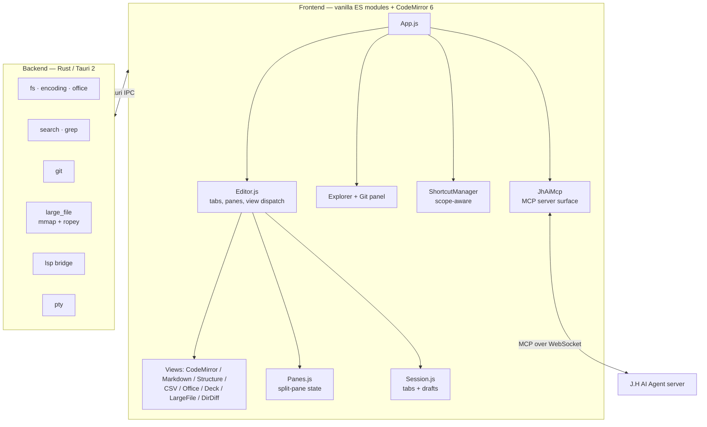

# J.H Editor

**English** | [日本語](README.ja.md)

A local-first desktop text editor built with **Tauri 2**, **vanilla JavaScript** and **CodeMirror 6**.

<p align="center">
  <picture>
    <source media="(prefers-color-scheme: dark)" srcset="docs/images/hero-dark.png">
    
  </picture>
</p>
<p align="center">
  <em>Book mode &mdash; a page-turning reading view for long documents, with Mermaid,
  tables and math intact. Shown in Hanging Scroll, the default theme; the screenshots
  follow GitHub's light / dark setting.</em>
</p>

J.H Editor is aimed at being the editor you leave open all day — a fast default for
plain text and **Markdown**, with structured-data tools (CSV / JSON / XML / HTML) and a
Git panel when you need them. It is not trying to be an IDE. Where AI is concerned it
plays the **companion** role: it exposes the document you are editing to an external
agent over MCP, rather than embedding an LLM stack of its own.

Double-click to editable, in well under a second. The window stays hidden until the
editor is actually ready, so there is no white flash and no empty frame.

### Where it earns its place

- **Finding one design document among thousands.** `Ctrl+Shift+R` (or `Ctrl+P`) narrows
  the whole workspace as you type — by name, by path, by glob (`*設計*.xlsx`) — and
  `Enter` opens an Excel workbook straight into a read-only Office preview that keeps
  its column widths, merged cells and borders. No waiting for Excel to start.
- **Fixing a CSV without having it reformatted.** A `.csv` opens as a table you can
  sort, resize and edit, and every cell stays the text it was — no dates turned into
  serial numbers, no leading zeros dropped, and a Shift_JIS file is saved as Shift_JIS.
- **Reading Markdown, and editing it a block at a time.** A `.md` file opens rendered —
  Mermaid, tables and math included — and a double-click (or `F2`) opens just that block
  beside a live preview.

---

## Screenshots

<p align="center">
  <picture>
    <source media="(prefers-color-scheme: dark)" srcset="docs/images/csv-dark.png">
    
  </picture>
</p>
<p align="center">
  <em>CSV opens as a grid &mdash; sort, resize, transpose, Excel-style insert/delete.
  Shift_JIS and other legacy encodings are detected, so no mojibake.</em>
</p>

<p align="center">
  <picture>
    <source media="(prefers-color-scheme: dark)" srcset="docs/images/diff-dark.png">
    
  </picture>
</p>
<p align="center">
  <em>Compare is a two-way merge &mdash; left-only, right-only and conflicting changes in
  their own colours, &larr; / &rarr; per change, and either side editable</em>
</p>

<p align="center">
  <picture>
    <source media="(prefers-color-scheme: dark)" srcset="docs/images/office-dark.png">
    
  </picture>
</p>
<p align="center">
  <em><code>.xlsx</code> opens in milliseconds as a read-only preview that keeps the sheet's
  column widths, merged cells and borders &mdash; a 方眼紙 design document still looks like one</em>
</p>

<p align="center">
  <picture>
    <source media="(prefers-color-scheme: dark)" srcset="docs/images/mermaid-dark.png">
    
  </picture>
</p>
<p align="center">
  <em>The Mermaid recipe helper &mdash; pick a diagram type and click the syntax you need,
  instead of re-reading the docs every time</em>
</p>

<p align="center">
  <picture>
    <source media="(prefers-color-scheme: dark)" srcset="docs/images/deck-dark.png">
    
  </picture>
</p>
<p align="center">
  <em>A jh-presentation deck opens as slides &mdash; slide list, speaker notes,
  presenter view, and text fixed in place</em>
</p>

---

## ✨ Features

### 📝 Editing modes

Each file opens in the view that suits it: **CSV** as a table, **Markdown** as rendered
blocks, a **jh-presentation deck** as slides, Office files in the preview, and everything
else — JSON, XML, HTML and TSV included — as **Text**. `Ctrl+Shift+E` switches modes for
that tab; the current mode is always shown in the status bar.

| Mode | What it is |
|------|-----------|
| **Text** | CodeMirror 6 with per-language syntax highlighting, bracket & selected-word matching, whitespace markers, code folding, word wrap, and a scrollbar minimap of search hits |
| **Markdown (block)** | Notion-style block editing. Double-click or `F2` opens a large split modal — source on the left, live preview on the right |
| **Structure** | Tree + source dual pane for JSON / XML / HTML / JSP, with drag-and-drop node manipulation |
| **Table (CSV/TSV)** | Spreadsheet-style grid: virtual scrolling, row/column select, resize, sort, transpose, Excel-style insert/delete keys |
| **Diff** | Side-by-side merge where either side can be edited: line-first diff (patience) with word-level highlights, changes marked as left-only / right-only / conflict, ← / → per change and *keep both* (either order) for conflicts (`Alt+M`), paired lines lined up inside a change, sync points to line up two lines by hand (`Alt+S`), a line-details pane showing the cursor line and its counterpart wrapped one above the other (`Alt+D`), one horizontal scrollbar moving both panes, whitespace-ignore toggle, and a change minimap |
| **3-way merge** | For a Git conflict: base, ours and theirs lined up row for row with the result. One click takes a side (or both); *Save and mark resolved* moves on to the next conflicted file |
| **Book** | Page-turning reading view (`Ctrl+Alt+B`) for long documents, with syntax highlighting intact |
| **Deck** | A [jh-presentation](https://github.com/pei-jz/jh-presentation) deck shown as slides. Double-click a box to fix its text in place; only that text changes in the source |
| **Office preview** | Read-only look inside `.xlsx` / `.xlsm` / `.xls` / `.ods` / `.docx` / `.pptx`, without waiting for Excel or Word to start |

### ✍️ Markdown

- **Live split preview** in the block edit modal
- **Mermaid** diagrams, with a **recipe helper** — pick a diagram type (sequence, flowchart,
  class, ER, state, gantt, mindmap, …) instead of re-reading the syntax every time
- **KaTeX** math, `[[WikiLinks]]` with backlink lookup, and **PDF export**
- **Paste or drop an image** — it is saved next to the document and linked relatively
- Click any diagram or image to open it full-size in a lightbox
- Reusable document **templates**
- **Document font** — choose the face and size used for Markdown prose (Meiryo by
  default, Yu Gothic, BIZ UD Gothic, …), the same in the scrolling and the page-turning view
- The block editor and the Mermaid helper go full screen with `F11` (or `Ctrl+Alt+F`);
  `Ctrl+S` saves without closing the block editor
- Prose is set in a reading face and code stays in the editor's fixed pitch, in both the
  scrolling and the page-turning view

### 🗂️ Files & search

- **Explorer** — a virtual-scrolled tree that behaves like an ordinary file manager:
  multi-select with the usual keys, drag to move or copy, `Delete` to the Recycle Bin,
  copy and paste to and from Windows Explorer (never overwriting a same-named file),
  *Copy path* / *Copy relative path*, "Reveal in File Explorer", and open tabs that
  follow a moved or renamed file
- **Workspaces** — several at once, and a recent-workspaces menu (`Ctrl+Alt+O`) to
  switch in one click
- **Workspace grep** (`Ctrl+G`) with **glob filters** (`*.java`), opening into its own results tab
- **File search** (`Ctrl+P` or `Ctrl+Shift+R`) — the workspace's file list is indexed
  once, then every keystroke narrows it in milliseconds. The best match comes first —
  exact name, then a name that starts with the query, then one that contains it, then
  the folder path — and the letters in order are enough (`flsrch` finds
  `FileSearch.js`); recently opened files win a tie. Globs work (`*設計*.xlsx`, or a
  path glob with `/`), and `Enter` opens the hit — a workbook straight into the Office
  preview, so finding one design document among thousands and reading it is a few keys
- **Tab search** (`Ctrl+T`), **outline** (`Ctrl+O`), **go to line** (`Ctrl+L`)
- **Compare** two files from the explorer, or two whole **folders** (recursive: differing files
  open as a diff, files present on only one side are marked `+` / `-`)
- **Huge files** — beyond a threshold, files open through a Rust `mmap` backend that serves
  only the visible lines; editing uses a `ropey`-backed sliding window, so a 100 MB log
  neither freezes the UI nor gets pulled into JS memory
- **Encoding** — auto-detection (`chardetng`) plus manual override (UTF-8, Shift-JIS, EUC-JP, …),
  and explicit CRLF/LF control that never changes on its own
- **Office files** — `.xlsx` / `.docx` / `.pptx` open in the preview below rather than
  being hidden as binaries; they appear in the explorer and in `Ctrl+P`

### 🎞️ Slides (jh-presentation decks)

A deck made by [jh-presentation](https://github.com/pei-jz/jh-presentation) is a single HTML
file, and it opens in **Deck View**: the slides themselves, with `←` / `→` to move through
them and `Ctrl+Shift+E` to switch to the source.

- **Asked once per file** — a deck runs its own scripts, so the first time a file is opened
  the view asks before showing it. The answer is remembered for that file.
- **Fix text in place** — double-click a box (or turn on *Edit text*), type, `Enter`. Only
  that element's text is rewritten in the source; the rest of the file stays byte for byte.
  If the source no longer matches what the slide showed, the edit is refused, not guessed.
- **`Ctrl+S` inside the slides** saves through the editor and ends edit mode; switching
  away and back returns to the same slide and step.
- **Slide list** — one rounded card per slide with its number and title. Click to jump;
  drag, `Alt+↑` / `Alt+↓` to reorder, `Ctrl+D` to duplicate, `Delete` to remove (no
  confirmation: it undoes).
- **Speaker notes** of the current slide are edited below the slides (`- ` bullets, `1. `
  numbering and `**bold**` are kept).
- **Ask AI to change** — a dialog where you write what to change, slide by slide (● on the
  card, a count on the button). *Ask AI* sends them all to J.H AI Agent and the slides come
  back as a proposal (*Show diff* / *Apply* / *Discard*). Without the agent, *Copy all
  requests* puts one prompt on the clipboard for Claude Code or any other AI; a request clears
  itself once that slide is changed in the file.
- **One undo history** — every change made in Deck View (text, order, notes) goes into the
  same history as the source view, so `Ctrl+Z` works in either and in the order things happened.
- **Source ⇄ slides** — `Ctrl+Shift+E` opens the source at the current slide, and back
  again shows the slide the cursor is in.
- **Present** — `F5` (or *Present*). With a second monitor (a projector), the slides open full
  screen there and this window becomes the presenter view: the current slide, a preview of
  the next one, the notes, a timer and Previous / Next. Moving in either window moves both;
  `Esc` in either ends it. With one monitor the slides fill the window, and `S` adds the same
  presenter panel beside them for rehearsing. *Open in browser* is there too, for presenting
  from the browser with the deck's own presenter view.
- The slides run in a sandboxed frame (`allow-scripts` only) and talk to the editor
  through `postMessage`, following jh-presentation's edit protocol.

### 📊 Office preview

Opening a spreadsheet to check one column should not cost an Excel cold start. These
open read-only, in milliseconds, from the file itself — `calamine` for workbooks and the
OOXML parts for `.docx` / `.pptx`. Nothing here can write, so a preview can never be
mistaken for an editor; the header has a button that hands the file to the real
application when it turns out you wanted that after all.

- **Spreadsheets** — sheet tabs, and the sheet's own **column widths, row heights, merged
  cells and borders**, so a Japanese 設計書 drawn on a grid of 2.5-character columns still
  looks like the page its author laid out. Dates are shown in the format the sheet asks
  for, formulas as their computed value. Gridlines follow the sheet's own setting and can
  be toggled; columns and rows can be dragged to a new size
- **Selecting and copying** — drag across cells, `Shift`+click to extend, `Ctrl+C` to copy
  the rectangle as TSV; it pastes straight back into Excel
- **Presentations** — title, indented bullets and speaker notes, slide by slide
- **Documents** — headings, paragraphs, both kinds of list, and tables
- **Moving about** — the arrow keys walk the selected cell and the sheet scrolls to
  follow, `Shift`+arrow stretches the range, and a merged box is one step across.
  `Ctrl+F` searches the preview; `Ctrl+PageUp` / `Ctrl+PageDown` move between sheets

Not carried over: fonts, fills, charts, images and shapes. What you get is the text and
the numbers, which is what a "let me just check something" open is after.

### 🪟 Window & session

- **Split editor** (`Ctrl+\`) with draggable tabs between panes, and drag-to-split
- **Session restore** — open tabs, active tab, split layout and scroll position come back
- **Draft recovery** — unsaved buffer text is persisted separately and restored after a crash
- **HTML preview** — for `.html` files, a side-by-side preview. Scripts are **off** by default;
  relative CSS/images resolve because their URLs are rewritten to absolute asset URLs

### 🐙 Git

- **Status panel** — branch selector (filterable), stage/unstage, commit, push/pull/fetch
- **Compare in an editor tab** — modified, added, deleted and untracked files against
  HEAD, from a click or the context menu; the working-tree side stays editable, and
  `Ctrl+↑` / `Ctrl+↓` step through the changed files
- **History graph** — commit list with search, a branch filter, per-commit file lists,
  two-revision comparison, and working-tree ↔ commit comparison
- **Merge, rebase, reset** — plus *Undo last commit*. Uncommitted changes are carried
  across; when a merge or rebase stops on a conflict, the first conflicted file opens
  in the 3-way merge view
- **Conflicts** — listed in their own section, with the merge/rebase state shown at the
  top; take one side from the context menu, or resolve line by line in the 3-way view.
  *Stage All* leaves conflicted files alone
- **Authentication in the editor** — username / password and SSH key passphrase prompts
  appear as an editor dialog, optionally remembered until J.H Editor closes. Git
  Credential Manager keeps working as before
- Status badges: `M` modified · `U` untracked · `D` deleted · `S` staged

### 🤖 AI (J.H AI Agent integration)

J.H Editor does **not** ship an LLM, embeddings, or a vector index. It connects to the
sibling **[J.H AI Agent](https://github.com/pei-jz/jh-ai-agent)** server and acts as an **MCP server toward it** —
the agent's model calls back into the editor for context.

- **Tools exposed to the agent** — `get_buffer`, `get_selection`, `list_open_files`,
  `read_workspace_file`, `list_workspace_files`, `get_diagnostics`
- **Inline AI** (`Ctrl+Space`) — Explain / Refactor / Add Types / Error Handling / To Code.
  Rewrites come back as a **diff you review and apply**, never as a silent buffer edit
- **Activity dock** — live task status with a Stop button
- **Pairing, not a token file** — the editor finds the agent on its own (the port it
  publishes, `14300` by default) and asks to connect; you approve in the agent's window
  after comparing a six-digit code. The grant lives in memory only, so closing either app
  ends it. A different address can be set in Settings

### 🧭 Language support

- **LSP** — `rust-analyzer` and `typescript-language-server` (completion, hover, diagnostics,
  Go to Definition `F12`, Find References `Shift+F12`). A status-bar warning appears when a
  server is configured but not installed; nothing is auto-installed
- **Vim mode** (`Ctrl+Alt+V`) via `@replit/codemirror-vim`

### 🎨 Customization

- **14 themes** (see [Themes](#-themes)), and a **theme per workspace** so windows on
  different projects are easy to tell apart
- **Fonts** — separate family/size for editor, UI, Markdown documents and terminal
- **Shortcuts** — scope-aware system with a searchable in-app guide (`F1`) and a command
  palette (`Ctrl+Shift+P`)
- **Integrated terminal** — xterm.js over a native PTY (toggled from the title bar).
  Dropping a file anywhere on it types the full path; the scrollback length is a setting

---

## 🎨 Themes

<p align="center">
  
</p>

| Theme | Base | Character |
|-------|------|-----------|
| Light | light | Plain white editor and explorer |
| Dark | dark | Neutral charcoal |
| Midnight | dark | Near-black with a blue-purple cast |
| Latte | light | Warm cream |
| Solarized Light | light | Solarized, with body text darkened for contrast |
| Solarized Dark | dark | Solarized, with contrast raised |
| Paper | light | Aged paper on a desk, ruled lines behind Markdown |
| Paper Dark | dark | Kraft paper at night; Book mode lays the sheet on a desk |
| Ink Brush (墨絵) | light | Washi, with ink-wash mountains along the mount |
| Ink Brush Dark | dark | Near-black ink |
| **Hanging Scroll (掛軸)** — default | light | Indigo brocade mount around moon-white silk |
| Hanging Scroll Dark | dark | Deep indigo silk, gold-damask mount, vermillion seal |
| Nord | dark | Nord's own palette, form controls included |
| Bamboo Slip (竹簡) | dark | Bamboo slips bound with cord, Mincho on the chrome |

*Base* is what the editor surface is, and it decides the syntax, Mermaid and terminal
palettes. Hanging Scroll counts as light: its mount is indigo, but the sheet you read is
pale silk. To add a theme, see [docs/THEMING.md](docs/THEMING.md).

---

## 🏗️ Architecture



### Design principles

- **No frontend framework** — plain ES modules with explicit DOM updates
- **Singleton state** — a small `Store.js`; pane/session logic is factored into pure,
  testable modules (`Panes.js`, `Session.js`) rather than living inside the DOM code
- **Rust-first I/O** — file access, encoding detection, grep, git and huge-file handling
  all happen in Rust
- **The editor is the context source, not the brain** — AI capability comes from the
  agent it connects to; the editor's job is to expose the document accurately and to
  make every AI edit reviewable

---

## 📦 Installing

Builds are published on the [Releases page](https://github.com/pei-jz/jh-editor/releases/latest).
Windows 10/11 (x64).

### About the install warning

This build is **not code-signed**, so the first time you run the installer
Windows will show:

> **Windows protected your PC**

Choose **More info → Run anyway**.

A signing certificate is a recurring annual cost, and this is a free
project, so there is not one yet. If you would rather not trust a binary,
you can build from source — see below.

Two things worth knowing:

- **Verify what you downloaded.** Every release lists a SHA-256 for its
  installer. Check it with
  `Get-FileHash <file> -Algorithm SHA256`.
- **Updates are signed regardless.** The updater carries its own signature
  scheme, independent of OS code signing, and the app refuses any update
  that is not signed with the project's key. Skipping code signing does not
  make the update channel forgeable.

<details>
<summary>日本語</summary>

このビルドは**コード署名されていません**。初回実行時に Windows が
「WindowsによってPCが保護されました」と表示します。
**［詳細情報］→［実行］** で進めてください。

署名証明書は年額費用がかかるため、無料配布の本プロジェクトでは現時点で
取得していません。バイナリを信用したくない場合は、ソースからビルドして
お使いいただけます。

- **ダウンロードしたものの検証** —— 各リリースにインストーラの SHA-256 を
  記載しています。`Get-FileHash <ファイル> -Algorithm SHA256` で照合できます。
- **更新は署名されています** —— 自動更新は OS のコード署名とは無関係の
  独自の署名機構を持ち、プロジェクトの鍵で署名されていない更新は
  インストールされません。コード署名をしないことと、更新経路の安全性は別です。

</details>

---

## 🚀 Getting started

### Prerequisites

- [Node.js](https://nodejs.org/) v18+
- [Rust](https://rustup.rs/) (latest stable)
- [Tauri CLI](https://tauri.app/start/) v2

> The `@jh/ai-client` dependency is resolved from `../jh-ai-agent/packages/jh-ai-client`.
> Check out both repositories side by side, or the install will fail.

```sh
npm install

# Development (Tauri shell + Vite HMR)
npm run tauri dev

# Production build
npm run tauri build
```

### Testing

```sh
# Unit tests (vitest, jsdom)
npm test

# With coverage — thresholds are checked when run with coverage
npm run test:coverage
```

Coverage thresholds (90% statements / lines / functions, 85% branches) apply to
the **logic** layer (utils, `Store`, `Session`, `Panes`, `ShortcutManager`,
`PluginManager`) and are enforced by `npm run test:coverage` — `npm test` runs the
unit suite without the coverage gate. Views and editors are driven by real
widgets; they are covered by the Playwright suite in `tests/e2e/`, which verifies
UI wiring that runs in a plain browser (settings/theme switching, new-file and
shortcut-guide modals).

### Recommended IDE setup

[VS Code](https://code.visualstudio.com/) + [Tauri](https://marketplace.visualstudio.com/items?itemName=tauri-apps.tauri-vscode) + [rust-analyzer](https://marketplace.visualstudio.com/items?itemName=rust-lang.rust-analyzer)

---

## 📁 Project structure

```
jh-editor/
├── src/
│   ├── modules/
│   │   ├── ai/            # JhAiMcp (MCP surface), jhai-adapter, activity dock
│   │   ├── core/          # App, Editor, Panes, Session, Store, Explorer, shortcuts
│   │   ├── editors/       # Csv, Merge (2-way), Conflict (3-way), Structure, Table, Compare, Vim
│   │   ├── lsp/           # LspClient, completion / hover / diagnostics widgets
│   │   ├── ui/            # Modals, Git panel + auth dialog, search, terminal, HTML preview, Mermaid helper
│   │   ├── utils/         # Parsers, highlighters, Markdown, VirtualScroll, FileSystem
│   │   ├── views/         # CodeMirror, Markdown, Structure, Csv, LargeFile, DirDiff, Office, Deck, GitCompare
│   │   └── workers/       # CSV / parser / formatter web workers
│   └── styles/            # Themes and component CSS
├── src-tauri/
│   └── src/commands/      # fs, search, git, large_file, office, lsp, parser, pty, app, window
├── docs/                  # Per-module reference docs (ja / en)
└── tests/                 # vitest unit tests + tests/e2e (Playwright)
```

---

## ⌨️ Key shortcuts

Press **`F1`** (or `Ctrl+/`) for the searchable in-app guide — it is generated from the same
definitions the app dispatches, so it cannot drift out of date.

| Shortcut | Action |
|----------|--------|
| `F1` / `Ctrl+/` | Shortcut guide |
| `Ctrl+S` | Save |
| `Ctrl+N` / `Ctrl+W` | New file / Close tab |
| `Ctrl+Tab` / `Ctrl+Shift+Tab` | Next / previous tab |
| `Ctrl+Shift+P` | Command palette |
| `Ctrl+P` / `Ctrl+Shift+R` | File search |
| `Ctrl+T` | Tab search |
| `Ctrl+G` | Workspace grep (supports globs) |
| `Ctrl+F` | Search in file |
| `F3` / `Shift+F3` | Find next / previous |
| `Ctrl+L` / `Ctrl+O` | Go to line / Outline |
| `Ctrl+Shift+E` | Toggle view mode (Text ⇄ Structure / Table / Markdown) |
| `Ctrl+Alt+P` | Toggle preview (Markdown / HTML) |
| `Ctrl+Alt+B` | Book mode |
| `F11` / `Ctrl+Alt+F` | Full screen — Markdown block editor and Mermaid helper (`Esc` steps back out) |
| `Ctrl+Alt+O` | Recent workspaces |
| `Ctrl+PageUp` / `Ctrl+PageDown` | Previous / next sheet in the Office preview |
| `Arrow keys` / `Shift`+arrow | Office preview: move the selected cell / stretch the range |
| `Ctrl+\` / `Ctrl+Alt+\` | Split editor right / down |
| `Ctrl+Shift+\` | Focus other pane |
| `Ctrl+Shift+W` | Close split |
| `Ctrl+Shift+D` / `Ctrl+Alt+D` | Compare with file / Compare scratch text |
| `Alt+M` / `Alt+S` / `Alt+D` / `Alt+I` | Compare: keep both / sync point / line details / ignore whitespace |
| `Ctrl+Space` | Inline AI |
| `Ctrl+Alt+C` | AI chat |
| `F12` / `Shift+F12` | Go to definition / Find references |
| `Ctrl+Alt+V` | Vim mode |
| `Ctrl+Alt+W` | Whitespace markers |
| `Shift+Alt+F` | Format |
| `Ctrl+1` / `Ctrl+2` | Focus explorer / editor |
| `F2` | Edit Markdown block · rename in explorer · edit CSV cell |

---

## 📚 Documentation

Per-file reference docs (methods and branches) live under `docs/`, in Japanese and English.

| Module | 日本語 | English |
|--------|--------|---------|
| Core | [docs/ja/core/](docs/ja/core/README.md) | [docs/en/core/](docs/en/core/README.md) |
| AI | [docs/ja/ai/](docs/ja/ai/README.md) | [docs/en/ai/](docs/en/ai/README.md) |
| Editors | [docs/ja/editors/](docs/ja/editors/README.md) | [docs/en/editors/](docs/en/editors/README.md) |
| UI | [docs/ja/ui/](docs/ja/ui/README.md) | [docs/en/ui/](docs/en/ui/README.md) |
| LSP | [docs/ja/lsp/](docs/ja/lsp/README.md) | [docs/en/lsp/](docs/en/lsp/README.md) |
| Utils | [docs/ja/utils/](docs/ja/utils/README.md) | [docs/en/utils/](docs/en/utils/README.md) |
| Views | [docs/ja/views/](docs/ja/views/README.md) | [docs/en/views/](docs/en/views/README.md) |
| Workers | [docs/ja/workers/](docs/ja/workers/README.md) | [docs/en/workers/](docs/en/workers/README.md) |
| Backend | [docs/ja/backend/](docs/ja/backend/README.md) | [docs/en/backend/](docs/en/backend/README.md) |

> These docs trail the source. Modules added recently — `Panes.js`, `Session.js`,
> `HtmlPreview.js`, `DirDiffView.js`, `MermaidHelper.js`, `SearchResultsView.js` — are not
> covered yet.

For cutting a build — version bumping, why releases are unsigned, and wiring
automatic updates — see **[docs/RELEASE.md](docs/RELEASE.md)**. For adding a
theme, or writing a component that follows one, see
**[docs/THEMING.md](docs/THEMING.md)**.

---

## 🔒 Rendering untrusted documents

Opening a file is not consent to run what is inside it. Markdown permits raw
HTML and `marked` passes it through, so everything rendered from document text
goes through `utils/SanitizeHtml.js` before it reaches the DOM — script tags,
event-handler attributes and `javascript:` URLs are removed, while tables, task
lists, code highlighting, images and Mermaid blocks are kept. Mermaid runs at
`securityLevel: 'strict'`, so a diagram's `click` directive cannot call into the
page. AI task results go through the same sanitiser, and file names and error
messages are always inserted as text, never as markup. HTML files preview inside a
sandboxed iframe with scripts off by default.

Git runs through `git_exec`, which takes an argument array — there is no general
shell command reachable from the webview.

---

## 📄 License

MIT — see [LICENSE](LICENSE).